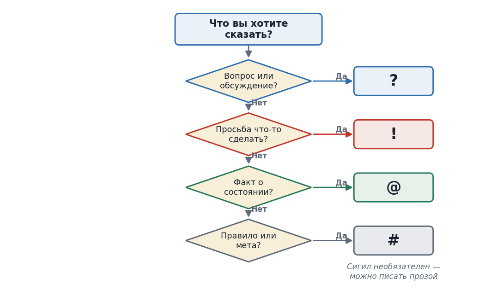

# 2. Основные идеи простыми словами

## 2.1. Аналогия с цветными стикерами

Представьте, что мы обмениваемся записками. Обычно записка --- это просто предложение, которое надо прочитать и понять, чего хочет автор. Это медленно и иногда неточно. Теперь представьте, что на каждой записке наклеен цветной стикер:

**синий** --- «я задаю вопрос, просто поговори со мной»; **красный** --- «сделай действие, вот задача»; **зелёный** --- «держи сведения, это не просьба, а факты»; **серый** --- «измени правило или подтверди».

Стикер необязателен --- можно писать и обычной речью, я пойму по смыслу. Но когда стикер есть, я вижу тип сообщения мгновенно и не гадаю. В нашем языке роль стикеров играют четыре символа (сигила): ?, !, @, #. Какой выбрать --- подскажет диаграмма ниже.

{width="5.905511811023622in" height="3.457688101487314in"}

*Диаграмма 1. Выбор сигила --- простое дерево решений.*

## 2.2. Аналогия с кулинарной привычкой (и процессором)

Вторая идея чуть хитрее, но тоже из жизни. Когда вы часто готовите одно и то же блюдо, вы замечаете закономерность: «если делаю пасту --- понадобится кипяток, соль и кастрюля». В следующий раз, только сказав себе «паста», вы уже ставите воду, не дожидаясь, пока перечитаете рецепт. Вы запомнили шаблон и готовитесь заранее.

Процессор вашего компьютера делает то же самое. Внутри него есть специальный буфер (он и называется BTB --- Branch Target Buffer), который запоминает: «после такой вот точки выбора программа прошлый раз пошла вот туда». И в следующий раз процессор заранее подтягивает нужные инструкции (команды), не дожидаясь, пока выбор разрешится. Если угадал --- сэкономил время. Если промахнулся --- выбрасывает подтянутое, вреда нет.

Я поступаю так же. У меня есть маленькая табличка-память с шаблонами ваших сообщений: «когда вы просите починить шейдер --- мне понадобятся вот эти файлы». Когда приходит ваше сообщение, я сразу начинаю читать эти файлы несколько штук одновременно (параллельно), пока ещё разбираю ваши точные слова. К моменту, как я понял задачу, файлы уже загружены. Угадал --- сэкономил. Промахнулся --- выкидываю прочитанное (это бесплатно), делаю аккуратно. Подробно --- в разделе 7.
