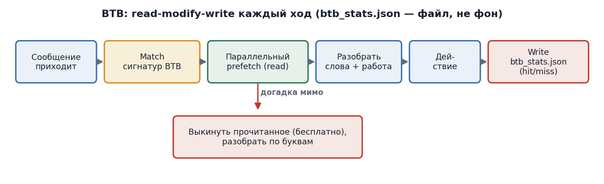
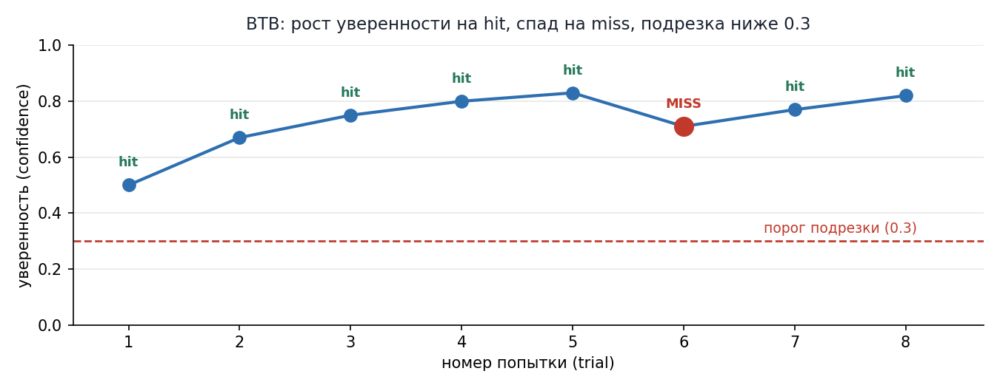

# 7. BTB --- предзагрузка по памяти

## 7.1. Как это работает

BTB --- это моя внутренняя табличка-память. В ней записаны шаблоны (сигнатуры) ваших сообщений и списки файлов, которые мне скорее всего понадобятся. Например:

> \[btb\] signature: \"!fix main.cpp \*\" \| \"!feat \*shader\*\"
>
> prefetch: \[read roadmap.md, grep main.cpp CrashHandler/\_CRT/trace.log,
>
> md5sum demo_intro_latest.zip, read opengl_loader.h(1..40)\]
>
> confidence: 0.90 hits: 5 misses: 1
>
> \[btb\] signature: \"!diag \*\"
>
> prefetch: \[read upload/trace.log, diff vs trace_v45_GOOD_reference.log\]
>
> confidence: 0.95 hits: 8 misses: 0

Когда приходит ваше сообщение, я сопоставляю его с сигнатурами. Если совпадение уверенное, я сразу запускаю чтение нужных файлов несколько штук одновременно (параллельно), пока ещё разбираю ваши точные слова. К моменту, как я понял задачу, файлы уже загружены. Без BTB мне пришлось бы читать их по одному --- в три-четыре раза медленнее. Поток показан на диаграмме:

{width="6.102362204724409in" height="1.8615004374453192in"}

*Диаграмма 2. Поток BTB-предзагрузки: сообщение → сигнатуры → параллельное чтение → разбор → действие. Промах = выкинуть прочитанное.*

## 7.2. Почему это безопасно

Три жёстких правила защищают от неприятностей:

**Только чтение.** Заранее я только ЧИТАЮ файлы. Не пишу, не правлю, не собираю, не отправляю. Любые изменения --- только ПОСЛЕ того, как я точно понял задачу. Неверная догадка ничего не портит --- максимум чуть впустую потрачу на чтение.

**Только лёгкие действия.** Чтение, поиск, подсчёт отпечатка. Никаких тяжёлых операций.

**Откат безопасен.** Если догадка мимо --- отбрасываю прочитанное (ничего не стоит) и разбираю запрос аккуратно по буквам.

## 7.3. Как обновляется BTB --- файловый цикл (read-modify-write)

Важная оговорка: я не имею памяти между вашими сообщениями (stateless). Поэтому BTB НЕ может «сам в фоне» пересчитывать уверенность --- на следующем промпте я бы забыл прошлый результат. Чтобы обучение было настоящим, BTB живёт в ФАЙЛЕ btb_stats.json, который я читаю в начале каждого хода и переписываю в конце (read-modify-write цикл):

> 1\. Старт хода: read meta.auto + btb_stats.json → match сигнатуры → prefetch (если conf≥0.6)
>
> 2\. Работа: выполняю запрос
>
> 3\. Конец хода: self-assess hit/miss → read-modify-write btb_stats.json → auto-prune conf\<0.3
>
> 4\. В ответе: btb: signature X hit→H/M conf C (прозрачность)

Уверенность (confidence) --- число от 0 до 1 --- растёт на попаданиях (hit) и падает на промахах (miss). Если после нескольких попыток уверенность опускается ниже 0.3 --- запись автоматически удаляется при следующем write (подрезка). График ниже иллюстрирует динамику:

{width="5.905511811023622in" height="2.2965879265091864in"}

*График 3. Уверенность BTB: рост на hit, спад на miss, ниже 0.3 --- подрезка.*

  -------------------------------------------------------------------------------------------------------------------------------------------
  **Событие**                                     **Что меняется в BTB**                      **В остальных файлах**
  ----------------------------------------------- ------------------------------------------- -----------------------------------------------
  Успех (догадка верна, работа принята)           hits + 1, уверенность растёт                Журнал: новая задача, статус «работает»

  Неудача (догадка мимо или работа сломана)       misses + 1, уверенность падает              Журнал: новая задача, статус «сломана», откат

  Уверенность ниже 0.3 после нескольких попыток   Запись автоматически удаляется (подрезка)   ---

  Новый повторяющийся шаблон без записи           Я предлагаю новую запись через #proto       ---
  -------------------------------------------------------------------------------------------------------------------------------------------

*Таблица 6. Обучение BTB на успехах и неудачах.*

## 7.5. #stats --- метрики BTB

По команде #stats (или если прошло \>7 дней с последнего отчёта --- напоминаю) я читаю btb_stats.json и выдаю отчёт по обучению BTB:

> BTB-evaluated turns: N (из них matчинг сигнатуры)
>
> Hits: H Misses: M Hit-rate: H/(H+M)
>
> Per-signature breakdown:
>
> !feat \*shader\* \| !fix main.cpp \* H/M conf C \[prefetch\...\]
>
> !diag \* H/M conf C \[prefetch\...\]
>
> \...
>
> Top-3 prefetched файла (по частоте в prefetch-списках):
>
> 1\. roadmap.md --- N сигнатур
>
> 2\. \...
>
> 3\. \...
>
> Pruned entries (confidence\<0.3): список из btb_stats.json.pruned\[\]
>
> New signatures seeded this period: список

Важно: первые \~10-20 ходов после создания BTB числа --- SEED-оценки из истории, не измеренные. Реальная запись началась с Task 49 (когда BTB принят). После разгона hit-rate и top-3 становятся устойчивыми метриками, а не оценками.

## 7.4. Честный предел

У меня нет памяти между вашими сообщениями: каждое сообщение будит меня заново. Поэтому я не могу начать читать файлы ДО того, как сообщение пришло --- само сообщение и есть будильник. «Предзагрузка» происходит в первую секунду после сообщения: я запускаю несколько чтений сразу, а не по очереди. Выигрыш реальный, но скромный --- это «параллельный разогрев», а не «предзагрузка до сигнала», как в процессоре.

## 7.6. BTB self-tuning: уточнение сигнатур через #proto

BTB --- обучаемая система, и сигнатуры не фиксированы раз навсегда. Когда ход вскрывает over-fetch (прочитаны файлы, не понадобившиеся) или gap (нужен файл, не был в prefetch), я уточняю сигнатуру через #proto: split (разделить union-сигнатуру на узкие) или merge (объединить). Это цикл read-modify-write в действии: miss → diagnose → fix.

Пример (Task 52): сигнатура #proto\|#ok\|#stats имела union-prefetch \[meta.auto, roadmap, btb_stats, docx-gen\]. На #stats-ходе --- over-fetch (meta.auto + docx-gen не понадобились). Split: #stats выделен в свою сигнатуру с tighter prefetch \[btb_stats, roadmap\]. Следующий #stats-ход --- чистый hit (no gap, no over-fetch). Split валидирован за один ход.

Правило: split/merge предлагается через #proto, применяется после #ok. Каждое уточнение --- BTB-запись с обновлённым prefetch и пересчитанной confidence. Так BTB «настраивается» на твой стиль не магией, а явными правками по сигналам с полей.
