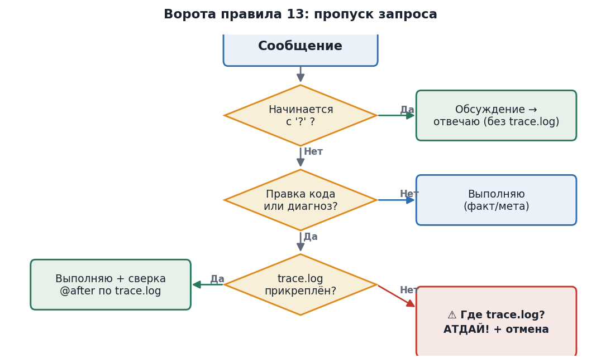

# 10. Правила взаимодействия

Поверх синтаксиса действуют три правила дисциплины обратной связи (записаны в журнале под номерами 12, 13, 14). Как они пропускают запрос --- на диаграмме:

{width="5.905511811023622in" height="3.5894094488188975in"}

*Диаграмма 4. Ворота правила 13: как запрос проходит или блокируется.*

  -------------------------------------------------------------------------------------------------------------------------------------------------------------------------------------------------------------------------------------------------------------------------------
  **Правило**                                    **Когда срабатывает**                                                                                **Что происходит**
  ---------------------------------------------- ---------------------------------------------------------------------------------------------------- ---------------------------------------------------------------------------------------------------------------------------
  12\. trace.log --- единый файл-отчёт           Всегда. Один файл = вывод компилятора + лог работы программы.                                        Вы присылаете его с каждым запросом по коду. В нём видно всё.

  13\. Нет trace.log → не выполнять запрос       Когда просите правку кода / диагноз, но не прикрепили trace.log (и сообщение не начинается с «?»).   Сразу вывожу «⚠ Где trace.log? Атдай!» и отменяю запрос.

  14\. Ведущий «?» → правило 13 приостановлено   Когда сообщение начинается с «?».                                                                    Считаем обсуждением --- trace.log не нужен. Если под «?» всё же правка кода --- делаю, но помечаю, что проверка отложена.
  -------------------------------------------------------------------------------------------------------------------------------------------------------------------------------------------------------------------------------------------------------------------------------

*Таблица 8. Три правила дисциплины обратной связи.*

Эти правила --- не формальность, а выжимка из реальной истории: мы потеряли много циклов на угадывание «что именно не работает», пока не ввели обязательный файл-отчёт и блок без него.

## 10.1. Kill-switch --- ОТКЛОНЁН (Tasks 64 + reqs_killswitch.md)

В ходе работы над code booster (Tasks 63-64) была предложена концепция kill-switch: новый сигил «×» с глаголами ×disallow / ×allow, карантинная папка disallowed/, registry.json, скрипт disallow_artifact.py, и три новых правила (16, 17, 18) для safe rejection артефактов протокола. Подробная спецификация сохранена в /home/z/my-project/download/reqs_killswitch.md (status: REJECTED).

Решение пользователя: ОТКЛОНИТЬ kill-switch целиком. Принцип: не плодить инфраструктуру «про запас» (тот же принцип, что при отказе !macro в Task 53). Если в будущем потребуется отказаться от артефакта --- это делается ad-hoc скриптом под конкретный случай, без общей инфраструктуры.

В протоколе остаётся 5 сигилов (? ! @ \# &), без «×». Rules 16-18 НЕ активны. Папки disallowed/ НЕ существует. Все упоминания kill-switch в roadmap/журналах помечены как REJECTED, но сохранены для истории.
